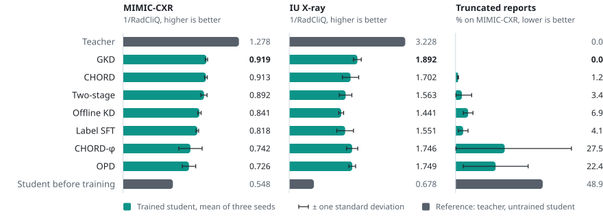

# Benchmark

Results of the methods in MedResidency on its tasks, with the command behind every row.

<p align="center">
  <picture>
    <source media="(prefers-color-scheme: dark)" srcset="../assets/benchmark-dark.svg">
    
  </picture>
</p>

<p align="center">
  <sub>
    Chest X-ray report generation with a 2B student and an 8B teacher, three seeds per method.
    The numbers are in the tables of <a href="#report-generation">Report generation</a>.
  </sub>
</p>

Within a table every run follows one protocol: the same student, data, number of optimizer steps, sequences per step,
learning rate, response limit and hardware. Only the method differs. Unless a table says otherwise, a number is the
mean over three seeds (42, 2, 3) at the final checkpoint, with greedy decoding on the test set, and the small number
after it is the standard deviation over the seeds.

> **Where the numbers come from.** The tables were produced with the research code that MedResidency was refactored
> from. They have not been re-run with this package. What we did check: for 40 of the recorded runs we compared the
> training arguments MedResidency builds with the arguments that were recorded at the time. 33 are identical; 7 differ
> only in how checkpoints are saved (`save_steps`, `save_only_model`). We also rebuilt the task files with
> `medres data` and compared them with the files the recorded runs read
> ([data.md](../docs/data.md#check-against-the-benchmarks-files)). If you reproduce a row, please
> [send us the result](#contributing-results).

## Contents

- [At a glance](#at-a-glance)
- [Protocol](#protocol)
- [Metrics and test sets](#metrics-and-test-sets)
- [Report generation](#report-generation)
- [Two teachers](#two-teachers)
- [Reasoning VQA](#reasoning-vqa)
- [Modality experts](#modality-experts)
- [A larger student](#a-larger-student)
- [A new teacher for a trained student](#a-new-teacher-for-a-trained-student)
- [Variants of OPD and CHORD](#variants-of-opd-and-chord)
- [Comparing two runs](#comparing-two-runs)
- [Contributing results](#contributing-results)

## At a glance

The best trained method of every setting on its headline metric, next to the student it started from and the teacher.

| Setting | Test set and metric | Student | Best method | Score | Teacher |
|:--|:--|--:|:--|--:|--:|
| [Report generation](#report-generation) | MIMIC-CXR, 1/RadCliQ ↑ | 0.548 | GKD | 0.919 | 1.278 |
| [Two teachers](#two-teachers) | MIMIC-CXR, 1/RadCliQ ↑ | 0.548 | CHORD (report) | 0.892 | 1.278 |
| | PMC-VQA, accuracy ↑ | 46.3 | CHORD (report) | 49.1 | 53.0 |
| [Reasoning VQA](#reasoning-vqa) | PMC-VQA, accuracy ↑ | 46.3 | OPD | 48.3 | 53.0 |
| [Modality experts](#modality-experts) | OmniMedVQA, accuracy ↑ | – | OPD | 95.48 | – |
| [A larger student](#a-larger-student) | MIMIC-CXR, 1/RadCliQ ↑ | 0.688 | GKD | 0.923 | 1.278 |
| [A new teacher for a trained student](#a-new-teacher-for-a-trained-student) | MIMIC-CXR, 1/RadCliQ ↑ | 0.570 | CHORD | 0.901 | 1.278 |
| | PMC-VQA, accuracy ↑ | 48.3 | CHORD | 48.9 | 53.0 |

No method is best everywhere, and several of these leads are within the spread of the seeds: the tables below give
the standard deviations. For the modality experts this page has no reference rows.

## Protocol

| | |
|:--|:--|
| Student | Qwen3-VL-2B-Instruct, full fine-tuning with the vision tower frozen, bf16, DeepSpeed ZeRO-2 |
| Teachers | 8B medical VLMs of the same model family, so teacher and student share a tokenizer. Each teacher runs in its own vLLM server and returns the log-probability of every sampled token (the top 20 for GKD) |
| Budget | 300 optimizer steps of 64 sequences, about one pass over 20,000 training prompts. Methods with an SFT term read 64 teacher outputs per step in addition |
| Learning rate | 5e-6 for reports and for two teachers, 1e-6 for reasoning VQA; constant, no warm-up |
| Response limit | 512 tokens for reports; 2,048 for reasoning VQA and for two teachers |
| Rollouts | sampled by the student at temperature 1, with a vLLM engine on the student's own GPUs |
| OPD loss | ms-swift's GRPO objective with the teacher term only: clipping ε = 0.2, no KL to a reference model |
| Hardware | four A40 (48 GB) per run, two for the student and two for the teacher servers; four H100 (80 GB) for the 4B student. Every evaluation runs on an A40 |
| Evaluation | final checkpoint, greedy decoding |

All of this is the default configuration: `configs/defaults.yaml` plus the task file. `medres train ... --print-config`
shows the resolved values of a run.

Training is noisy: the same recipe run twice differed by 0.048 in MIMIC-CXR 1/RadCliQ between two GPU types. Keep
the runs you compare on one GPU type, and do not read a single-seed difference of that size as a result.

## Metrics and test sets

Reports are scored on findings and impression together.

- **1/RadCliQ** is the headline metric: the reciprocal of the mean RadCliQ-v1 over the test studies.
- **RadGraph** (F1), **RaTE** (RaTEScore), **CheXbert-5** (micro-F1 over five conditions) and **GREEN** are shown on a
  0–100 scale.
- **Trunc.** is the share (%) of MIMIC-CXR test reports that reach the generation limit of 1,024 tokens. A student
  that has collapsed into repetition shows up here.

VQA is scored by accuracy (%) over all questions. A response with no recognizable option counts as wrong.

| Test set (`--sets`) | Task | Size | Source |
|:--|:--|--:|:--|
| `mimic_cxr` | `cxr_report` | 1,624 studies | MIMIC-CXR test split of ReXrank |
| `iu_xray` | `cxr_report` | 590 studies | IU X-ray test split of ReXrank; no IU X-ray study is used in training |
| `pmc_vqa` | `med_vqa` | 1,000 questions | PMC-VQA v2 test |
| `medxpertqa_mm` | `med_vqa` | 1,581 questions | MedXpertQA MM, the single-image questions |
| `mmmu_health` | `med_vqa` | 136 questions | MMMU validation, health and medicine subjects (one image, at most five options) |
| `omnimedvqa` | `modality_experts` | 17,662 questions | Med-R1's test split of OmniMedVQA |

The task `cxr_report_vqa` is evaluated on the five sets of `cxr_report` and `med_vqa`.

An arrow in a column title says whether higher (↑) or lower (↓) is better. In the tables of the six settings the best
trained method of a column is in bold. The first rows (the teachers, the student the run starts from) are references
and are not ranked.

## Report generation

Task `cxr_report`: one teacher, UniRG-CXR, on 20,000 MIMIC-CXR training studies with one frontal image each. Plain
OPD collapses into repetition on some seeds of this task, which is what its truncation column shows.

**MIMIC-CXR test**, 1,624 studies

| Method | 1/RadCliQ ↑ | RadGraph ↑ | RaTE ↑ | CheXbert-5 ↑ | GREEN ↑ | Trunc. ↓ |
|:--|--:|--:|--:|--:|--:|--:|
| Teacher (UniRG-CXR-8B) | 1.278 | 29.7 | 63.9 | 65.6 | 40.4 | 0.0 |
| Student before training (Qwen3-VL-2B) | 0.548 | 11.1 | 50.8 | 27.8 | 21.2 | 48.9 |
| Label SFT | 0.818 <sub>± 0.015</sub> | 18.3 <sub>± 0.4</sub> | 56.4 <sub>± 0.2</sub> | 41.5 <sub>± 3.5</sub> | 29.3 <sub>± 0.8</sub> | 4.1 <sub>± 2.7</sub> |
| Offline KD | 0.841 <sub>± 0.019</sub> | 20.0 <sub>± 0.2</sub> | 56.9 <sub>± 0.4</sub> | 43.4 <sub>± 5.0</sub> | 30.3 <sub>± 0.1</sub> | 6.9 <sub>± 2.7</sub> |
| OPD | 0.726 <sub>± 0.074</sub> | 17.4 <sub>± 0.9</sub> | 56.5 <sub>± 2.2</sub> | 39.1 <sub>± 10.3</sub> | 24.8 <sub>± 1.9</sub> | 22.4 <sub>± 18.3</sub> |
| GKD | **0.919** <sub>± 0.013</sub> | **21.6** <sub>± 0.2</sub> | 59.0 <sub>± 0.3</sub> | 42.7 <sub>± 5.7</sub> | **31.0** <sub>± 0.4</sub> | **0.0** <sub>± 0.0</sub> |
| CHORD | 0.913 <sub>± 0.015</sub> | 21.5 <sub>± 0.3</sub> | **59.1** <sub>± 0.6</sub> | 51.5 <sub>± 3.4</sub> | 30.1 <sub>± 1.4</sub> | 1.2 <sub>± 0.3</sub> |
| CHORD-φ | 0.742 <sub>± 0.129</sub> | 18.5 <sub>± 1.4</sub> | 57.6 <sub>± 0.9</sub> | 42.1 <sub>± 6.6</sub> | 26.2 <sub>± 2.0</sub> | 27.5 <sub>± 37.6</sub> |
| Two-stage | 0.892 <sub>± 0.034</sub> | 21.4 <sub>± 1.0</sub> | 58.9 <sub>± 1.2</sub> | **52.1** <sub>± 0.7</sub> | 30.4 <sub>± 3.1</sub> | 3.4 <sub>± 5.5</sub> |

**IU X-ray test**, 590 studies; no IU X-ray study is used in training

| Method | 1/RadCliQ ↑ | RadGraph ↑ | RaTE ↑ |
|:--|--:|--:|--:|
| Teacher (UniRG-CXR-8B) | 3.228 | 37.6 | 70.9 |
| Student before training (Qwen3-VL-2B) | 0.678 | 15.0 | 55.5 |
| Label SFT | 1.551 <sub>± 0.234</sub> | 24.1 <sub>± 3.7</sub> | 62.2 <sub>± 3.7</sub> |
| Offline KD | 1.441 <sub>± 0.068</sub> | 24.8 <sub>± 0.4</sub> | 66.0 <sub>± 1.1</sub> |
| OPD | 1.749 <sub>± 0.094</sub> | 26.9 <sub>± 0.2</sub> | 67.7 <sub>± 0.8</sub> |
| GKD | **1.892** <sub>± 0.109</sub> | **28.9** <sub>± 0.2</sub> | **68.1** <sub>± 0.5</sub> |
| CHORD | 1.702 <sub>± 0.227</sub> | 27.4 <sub>± 1.2</sub> | 67.1 <sub>± 1.0</sub> |
| CHORD-φ | 1.746 <sub>± 0.157</sub> | 26.9 <sub>± 1.1</sub> | **68.1** <sub>± 1.3</sub> |
| Two-stage | 1.563 <sub>± 0.176</sub> | 27.0 <sub>± 0.9</sub> | 67.0 <sub>± 0.3</sub> |

<details>
<summary>Commands</summary>

```bash
# the two reference rows
medres eval run --task cxr_report --model models/UniRG-CXR --green
medres eval run --task cxr_report --model models/Qwen3-VL-2B-Instruct --green

# one method, three seeds
for seed in 42 2 3; do
    medres train --task cxr_report --method gkd --seed $seed
    medres eval run --task cxr_report --model runs/cxr_report_gkd_s$seed/checkpoint-300 --green
done
```

| Row | `--method` | |
|:--|:--|:--|
| Label SFT | `sft` | on the reference reports |
| Offline KD | `offline_kd` | SFT on the teacher's outputs |
| OPD | `opd` | |
| GKD | `gkd` | |
| CHORD | `chord` | cosine decay of μ from 1 to 0 over the 300 steps |
| CHORD-φ | `chord_phi` | |
| Two-stage | `two_stage` | 150 steps of offline KD, then 150 of OPD; the final checkpoint is `checkpoint-150` |

</details>

## Two teachers

Task `cxr_report_vqa`: UniRG-CXR teaches 10,000 report prompts and MediX-R1-8B teaches 10,000 PMC-VQA questions, mixed
in one run. One student serves both tasks. The first four columns score its reports, the last three are VQA accuracy.

| Method | MIMIC 1/RadCliQ ↑ | MIMIC RaTE ↑ | MIMIC GREEN ↑ | IU 1/RadCliQ ↑ | PMC-VQA ↑ | MedXpertQA ↑ | MMMU-H&M ↑ |
|:--|--:|--:|--:|--:|--:|--:|--:|
| Teachers (UniRG-CXR-8B, MediX-R1-8B) | 1.278 | 63.9 | 40.4 | 3.228 | 53.0 | 30.2 | 68.4 |
| Student before training (Qwen3-VL-2B) | 0.548 | 50.8 | 21.2 | 0.678 | 46.3 | 16.3 | 41.9 |
| Offline KD | 0.788 <sub>± 0.013</sub> | 56.6 <sub>± 0.3</sub> | 28.7 <sub>± 0.4</sub> | 1.715 <sub>± 0.166</sub> | 46.0 <sub>± 2.7</sub> | 17.6 <sub>± 0.9</sub> | 43.6 <sub>± 3.0</sub> |
| OPD | 0.619 <sub>± 0.143</sub> | 53.9 <sub>± 3.7</sub> | 22.0 <sub>± 5.9</sub> | 1.478 <sub>± 0.604</sub> | 46.6 <sub>± 2.7</sub> | 17.1 <sub>± 2.1</sub> | 46.1 <sub>± 1.1</sub> |
| GKD | 0.847 <sub>± 0.008</sub> | 57.8 <sub>± 0.6</sub> | 28.4 <sub>± 0.9</sub> | 1.902 <sub>± 0.082</sub> | 47.9 <sub>± 0.3</sub> | 19.9 <sub>± 0.4</sub> | 46.4 <sub>± 1.3</sub> |
| CHORD (both) | 0.874 <sub>± 0.027</sub> | **58.9** <sub>± 0.2</sub> | 29.6 <sub>± 0.8</sub> | **1.933** <sub>± 0.015</sub> | 47.0 <sub>± 1.6</sub> | 19.8 <sub>± 0.4</sub> | 46.6 <sub>± 2.8</sub> |
| CHORD (report) | **0.892** <sub>± 0.036</sub> | 58.1 <sub>± 1.1</sub> | 28.9 <sub>± 1.7</sub> | 1.589 <sub>± 0.243</sub> | **49.1** <sub>± 1.0</sub> | 20.9 <sub>± 0.6</sub> | **47.5** <sub>± 4.3</sub> |
| Two-stage (both) | 0.888 <sub>± 0.033</sub> | 58.3 <sub>± 1.1</sub> | **29.7** <sub>± 0.8</sub> | 1.785 <sub>± 0.205</sub> | 48.7 <sub>± 0.4</sub> | 19.1 <sub>± 0.5</sub> | 46.8 <sub>± 1.1</sub> |
| Two-stage (report) | 0.888 <sub>± 0.041</sub> | 58.6 <sub>± 0.5</sub> | 29.4 <sub>± 0.3</sub> | 1.840 <sub>± 0.069</sub> | 48.1 <sub>± 1.0</sub> | **21.2** <sub>± 1.0</sub> | 47.3 <sub>± 2.9</sub> |

"Both" and "report" say which teacher outputs the SFT term reads: those of both teachers on the 20,000 mixed prompts,
which is the task's default, or the report teacher's outputs on the 20,000 studies of the report task.

<details>
<summary>Commands</summary>

```bash
medres train --task cxr_report_vqa --method chord --seed 42                              # CHORD (both)
medres train configs/recipes/benchmark/cxr_report_vqa_chord_report.yaml --seed 42        # CHORD (report)
medres train --task cxr_report_vqa --method two_stage --seed 42                          # Two-stage (both)
medres train configs/recipes/benchmark/cxr_report_vqa_two_stage_report.yaml --seed 42    # Two-stage (report)

medres eval run --task cxr_report_vqa --model runs/cxr_report_vqa_chord_s42/checkpoint-300 --green
```

A run started from a recipe is named after the recipe file: `runs/cxr_report_vqa_chord_report_s42`.

</details>

## Reasoning VQA

Task `med_vqa`: MediX-R1-8B on 20,000 PMC-VQA training questions, with long step-by-step rationales. Student and
teacher start close to each other here, and plain OPD works well: this is the control task.

| Method | PMC-VQA ↑ | MedXpertQA ↑ | MMMU-H&M ↑ |
|:--|--:|--:|--:|
| Teacher (MediX-R1-8B) | 53.0 | 30.2 | 68.4 |
| Student before training (Qwen3-VL-2B) | 46.3 | 16.3 | 41.9 |
| Offline KD | 46.1 <sub>± 0.3</sub> | 17.3 <sub>± 1.4</sub> | 44.8 <sub>± 2.0</sub> |
| OPD | **48.3** <sub>± 1.0</sub> | **19.3** <sub>± 1.3</sub> | 44.9 <sub>± 3.0</sub> |
| GKD | 46.7 <sub>± 1.0</sub> | 17.8 <sub>± 0.7</sub> | 42.6 <sub>± 0.8</sub> |
| CHORD | 47.3 <sub>± 0.8</sub> | **19.3** <sub>± 0.6</sub> | 46.3 <sub>± 3.4</sub> |
| Two-stage | 47.9 <sub>± 0.7</sub> | 19.0 <sub>± 1.1</sub> | **48.5** <sub>± 0.8</sub> |

<details>
<summary>Commands</summary>

```bash
medres train --task med_vqa --method opd --seed 42
medres eval run --task med_vqa --model runs/med_vqa_opd_s42/checkpoint-300
```

</details>

## Modality experts

Task `modality_experts`: the eight Med-R1 experts (one Qwen2-VL-2B per imaging modality, trained with GRPO on
OmniMedVQA) are distilled back into the base Qwen2-VL-2B. Each prompt is scored by the expert of its modality. The
protocol differs from the other tasks: 500 steps of 128 sequences, learning rate 5e-6, response limit 512 tokens.

| Method | OmniMedVQA accuracy ↑ |
|:--|--:|
| Offline KD | 94.28 |
| OPD | **95.48** |

Means of three seeds, on the test questions with Med-R1's prompt. The three OPD seeds range from 94.07 to 97.12.

<details>
<summary>Commands</summary>

```bash
medres train --task modality_experts --method opd --seed 42
medres eval run --task modality_experts --model runs/modality_experts_opd_s42/checkpoint-500
```

In the recorded runs of this task the seed changed the sampling and initialization noise but not the order of the
data. MedResidency also seeds the data order, so seeds 2 and 3 will not see the prompts in the recorded order.

</details>

## A larger student

The report task with Qwen3-VL-4B-Instruct as the student, on four 80 GB GPUs. Everything else is unchanged.

**MIMIC-CXR test**

| Method | 1/RadCliQ ↑ | RadGraph ↑ | RaTE ↑ | CheXbert-5 ↑ | GREEN ↑ | Trunc. ↓ |
|:--|--:|--:|--:|--:|--:|--:|
| Teacher (UniRG-CXR-8B) | 1.278 | 29.7 | 63.9 | 65.6 | 40.4 | 0.0 |
| Student before training (Qwen3-VL-4B) | 0.688 | 12.2 | 52.2 | 35.3 | 23.4 | 0.7 |
| Offline KD | 0.898 <sub>± 0.010</sub> | 21.7 <sub>± 0.2</sub> | 58.1 <sub>± 0.2</sub> | 46.2 <sub>± 3.1</sub> | 31.5 <sub>± 0.3</sub> | 2.8 <sub>± 1.0</sub> |
| OPD | 0.525 <sub>± 0.156</sub> | 13.4 <sub>± 4.7</sub> | 50.7 <sub>± 6.3</sub> | 31.2 <sub>± 7.9</sub> | 18.2 <sub>± 5.5</sub> | 66.9 <sub>± 27.7</sub> |
| GKD | **0.923** <sub>± 0.022</sub> | **22.0** <sub>± 0.2</sub> | 58.6 <sub>± 1.0</sub> | 43.9 <sub>± 6.4</sub> | 30.6 <sub>± 0.3</sub> | 1.1 <sub>± 1.8</sub> |
| CHORD | 0.908 <sub>± 0.037</sub> | **22.0** <sub>± 0.9</sub> | **59.7** <sub>± 0.7</sub> | **52.9** <sub>± 8.4</sub> | **32.2** <sub>± 0.2</sub> | 3.9 <sub>± 3.6</sub> |
| CHORD-φ | 0.746 <sub>± 0.066</sub> | 19.2 <sub>± 1.2</sub> | 56.7 <sub>± 1.0</sub> | 32.4 <sub>± 1.5</sub> | 25.0 <sub>± 3.0</sub> | 21.2 <sub>± 13.1</sub> |
| Two-stage | 0.882 <sub>± 0.008</sub> | 21.1 <sub>± 0.3</sub> | 58.6 <sub>± 0.5</sub> | 44.0 <sub>± 7.1</sub> | 29.4 <sub>± 0.9</sub> | **0.9** <sub>± 1.0</sub> |

**IU X-ray test**

| Method | 1/RadCliQ ↑ | RadGraph ↑ | RaTE ↑ |
|:--|--:|--:|--:|
| Teacher (UniRG-CXR-8B) | 3.228 | 37.6 | 70.9 |
| Student before training (Qwen3-VL-4B) | 0.816 | 12.6 | 54.4 |
| Offline KD | 1.442 <sub>± 0.038</sub> | 25.0 <sub>± 0.5</sub> | 65.9 <sub>± 0.6</sub> |
| OPD | 1.243 <sub>± 0.715</sub> | 26.4 <sub>± 1.6</sub> | 65.4 <sub>± 3.4</sub> |
| GKD | 1.785 <sub>± 0.114</sub> | 28.0 <sub>± 0.3</sub> | 67.1 <sub>± 0.8</sub> |
| CHORD | 1.666 <sub>± 0.148</sub> | 27.1 <sub>± 1.4</sub> | 67.6 <sub>± 0.5</sub> |
| CHORD-φ | **1.890** <sub>± 0.061</sub> | **28.4** <sub>± 0.1</sub> | **68.2** <sub>± 0.1</sub> |
| Two-stage | 1.499 <sub>± 0.093</sub> | 25.5 <sub>± 0.5</sub> | 66.5 <sub>± 0.9</sub> |

<details>
<summary>Commands</summary>

```bash
medres train configs/recipes/benchmark/cxr_report_4b.yaml --method gkd --seed 42      # any method
medres eval run --task cxr_report --model runs/cxr_report_4b_gkd_s42/checkpoint-300 --green
```

</details>

## A new teacher for a trained student

The student has already been trained: it is the OPD student of the [reasoning VQA](#reasoning-vqa) task. The report
teacher is now added, and training continues with both teachers on the mixed prompts of `cxr_report_vqa`. The report
columns measure the new skill, the VQA columns the skill to keep.

| Method | MIMIC 1/RadCliQ ↑ | MIMIC RaTE ↑ | MIMIC GREEN ↑ | IU 1/RadCliQ ↑ | PMC-VQA ↑ | MedXpertQA ↑ | MMMU-H&M ↑ |
|:--|--:|--:|--:|--:|--:|--:|--:|
| Teachers (UniRG-CXR-8B, MediX-R1-8B) | 1.278 | 63.9 | 40.4 | 3.228 | 53.0 | 30.2 | 68.4 |
| VQA-trained student (Qwen3-VL-2B) | 0.570 <sub>± 0.005</sub> | 52.4 <sub>± 0.2</sub> | 21.9 <sub>± 0.3</sub> | 0.730 <sub>± 0.003</sub> | 48.3 <sub>± 1.0</sub> | 19.3 <sub>± 1.3</sub> | 44.9 <sub>± 3.0</sub> |
| Offline KD | 0.784 <sub>± 0.011</sub> | 56.6 <sub>± 0.1</sub> | 27.8 <sub>± 0.4</sub> | 1.712 <sub>± 0.268</sub> | 45.9 <sub>± 1.9</sub> | 18.0 <sub>± 0.3</sub> | 42.4 <sub>± 0.9</sub> |
| OPD | 0.505 <sub>± 0.008</sub> | 57.4 <sub>± 0.1</sub> | 28.6 <sub>± 2.8</sub> | 0.595 <sub>± 0.036</sub> | 48.1 <sub>± 2.3</sub> | 17.2 <sub>± 1.1</sub> | **44.6** <sub>± 2.4</sub> |
| GKD | 0.855 <sub>± 0.022</sub> | 58.1 <sub>± 0.6</sub> | 29.3 <sub>± 0.2</sub> | **1.962** <sub>± 0.022</sub> | 47.2 <sub>± 1.7</sub> | 17.3 <sub>± 1.4</sub> | 44.4 <sub>± 2.1</sub> |
| CHORD | **0.901** <sub>± 0.024</sub> | **58.2** <sub>± 0.3</sub> | **29.6** <sub>± 1.5</sub> | 1.724 <sub>± 0.137</sub> | **48.9** <sub>± 0.7</sub> | **20.6** <sub>± 0.6</sub> | 43.9 <sub>± 3.0</sub> |
| Two-stage | 0.853 <sub>± 0.036</sub> | 58.0 <sub>± 0.4</sub> | 29.1 <sub>± 1.4</sub> | 1.935 <sub>± 0.015</sub> | 47.2 <sub>± 0.7</sub> | 18.7 <sub>± 0.3</sub> | 43.9 <sub>± 1.2</sub> |

CHORD and the two-stage recipe read the outputs of both teachers, which is the task's default.

<details>
<summary>Commands</summary>

```bash
medres train --task med_vqa --method opd --seed 42                                  # the trained student
medres train configs/recipes/benchmark/new_teacher.yaml --method chord --seed 42
medres eval run --task cxr_report_vqa --model runs/new_teacher_chord_s42/checkpoint-300 --green
```

Each seed starts from the student of the same seed:

```bash
medres train configs/recipes/benchmark/new_teacher.yaml --method chord --seed 2 \
    student.init=runs/med_vqa_opd_s2/checkpoint-300
```

</details>

## Variants of OPD and CHORD

On the report task. **Loop** is the longest run of consecutive training steps in which at least half of the rollouts
reach the response limit (`completions/clipped_ratio` in `logging.jsonl`). A range is over the seeds.

**The schedule of the SFT weight μ.** The loss is (1 − μ) · OPD + μ · SFT on teacher outputs. A cosine schedule
decays μ from 1 to 0 over the given steps, and the run trains as OPD afterwards.

| Schedule of μ | Loop ↓ | MIMIC-CXR 1/RadCliQ ↑ | IU X-ray 1/RadCliQ ↑ |
|:--|--:|--:|--:|
| None, μ = 0 (OPD) | 12–24 | 0.726 <sub>± 0.074</sub> | 1.749 <sub>± 0.094</sub> |
| Cosine over 300 steps (CHORD) | 0 | 0.913 <sub>± 0.015</sub> | 1.702 <sub>± 0.227</sub> |
| Cosine over 100 steps | 0 | **0.924** <sub>± 0.010</sub> | **1.893** <sub>± 0.050</sub> |
| Cosine over 50 steps | 0 | 0.860 <sub>± 0.123</sub> | 1.841 <sub>± 0.153</sub> |
| From 0.9 to 0.05 over 200 steps, then 0.05 (the CHORD authors' schedule) | 0 | 0.897 <sub>± 0.099</sub> | 1.710 <sub>± 0.414</sub> |

<details>
<summary>Commands</summary>

Every row is an override of one run. Give each variant its own `--name`, or it will collide with the default run:

```bash
medres train --task cxr_report --method chord method.decay_steps=100 --name cxr_report_cosine100_s42
medres train --task cxr_report --method chord method.decay_steps=50 --name cxr_report_cosine50_s42
medres train --task cxr_report --method chord method.peak=0.9 method.valley=0.05 method.decay_steps=200 \
    --name cxr_report_chord_authors_s42
```

</details>

**Remedies for a collapsing OPD run**, without an SFT term. None of the three removes the loop.

| Variant | Seeds | Loop ↓ | MIMIC-CXR 1/RadCliQ ↑ | IU X-ray 1/RadCliQ ↑ | Trunc. ↓ |
|:--|--:|--:|--:|--:|--:|
| OPD | 3 | 12–24 | 0.726 <sub>± 0.074</sub> | 1.749 <sub>± 0.094</sub> | 22.4 <sub>± 18.3</sub> |
| OPD + repetition penalty 1.2 | 1 | 171 | 0.316 | 0.331 | 100.0 |
| OPD, learning rate 1e-6 | 1 | 42 | 0.774 | 1.808 | 10.5 |
| OPD + KL to the initial student | 1 | 22 | 0.823 | 1.974 | 4.1 |

The rows with one seed are seed 42.

<details>
<summary>Commands</summary>

```bash
medres train --task cxr_report --method opd method.repetition_penalty=1.2 --name cxr_report_opd_reppen_s42
medres train --task cxr_report --method opd train.lr=1e-6 --name cxr_report_opd_lr1e-6_s42
medres train --task cxr_report --method opd train.swift_args.beta=0.04 --name cxr_report_opd_kl_s42
```

The KL to the initial student has no key of its own: `beta` is the argument of ms-swift's trainer, passed through
`train.swift_args`.

</details>

Baselines run at their authors' settings. If you tune a baseline, tune it on a validation set
([evaluation.md](../docs/evaluation.md#validation)), never on a test set, and say so.

## Comparing two runs

`medres eval run` writes one line per test item next to each summary. `medres stats compare` reads two such files and
gives the paired difference with a 95% bootstrap interval (1,000 resamples):

```bash
medres stats compare evals/cxr_report_gkd_s42/checkpoint-300/mimic_cxr.scores.jsonl \
    evals/cxr_report_chord_s42/checkpoint-300/mimic_cxr.scores.jsonl \
    --metric inv_radcliq --cluster-data data/cxr_report/test_mimic.jsonl

medres stats compare evals/med_vqa_opd_s42/checkpoint-300/pmc_vqa.items.jsonl \
    evals/med_vqa_chord_s42/checkpoint-300/pmc_vqa.items.jsonl --metric accuracy
```

`--cluster-data` resamples patients instead of studies, because a patient can have several studies in the MIMIC-CXR
test set.

How the benchmark reads a comparison:

- Compare seed by seed. The interval covers the test set, not the randomness of training.
- A **win** or **loss** needs an interval that excludes zero.
- A **tie** is an interval that contains zero with a difference below 0.01 in 1/RadCliQ (0.5 points for the other
  metrics).
- Anything else is **undetermined**.
- "Better" in the tables means a higher mean over the seeds; significance is reported separately.

## Contributing results

New rows are welcome: a reproduction of a row above, a new method on an existing task, or a new task with its
baselines. Open a pull request that adds the row and gives

- the commands, and the commit of MedResidency they were run with;
- the GPUs, and the seeds (three, if you can afford them);
- the numbers from `evals/<run>/<checkpoint>/summary.json`.

Send aggregates only. Reports generated for MIMIC-CXR studies are credentialed data under the PhysioNet agreement and
must not be uploaded, and neither should per-study scores or logs that contain report text.

The figure at the top of this page is drawn from the two tables of [Report generation](#report-generation). After
changing them, run `python scripts/plot_benchmark.py` and commit the two files it writes.

The method `grpo` (reinforcement learning with a task reward, `medres list rewards`) is implemented but has no row
yet. It is a good place to start.
